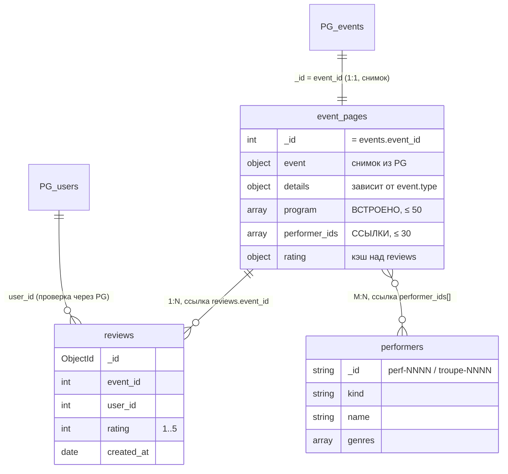

# Sprint 5

В первом задании был разработан и протестирован каталог из 8 содержательных SQL-запросов для аналитики и бизнес-отчетности приложения Poster.

Все запросы расположены в директории `scripts/queries/` и могут быть выполнены одной командой:
```bash
make queries-head
```

Или запуск с нуля бд с накотом миграций, генерацие данных и создание 8 SQL-запросов
```bash
make sprint_5_request_8 
```

## Каталог запросов (scripts/queries/)

| # | Файл | Суть | Оконные функции / конструкции |
|---|------|------|-------------------------------|
| 1 | 01_catalog.sql | Каталог предстоящих опубликованных событий | JOIN, фильтрация, пагинация |
| 2 | 02_user_orders.sql | История заказов покупателя | JOIN, сортировка |
| 3 | 03_tickets_per_event.sql | Продано билетов и выручка по событиям | Агрегация GROUP BY |
| 4 | 04_revenue_per_event.sql | Ранг событий по выручке внутри типа | CTE + RANK() OVER (PARTITION BY) |
| 5 | 05_active_buyers.sql | Активные покупатели (>1 опл. заказа) | CTE + JOIN |
| 6 | 06_user_order_lag.sql | Интервалы между заказами покупателя | LAG() OVER (PARTITION BY) |
| 7 | 07_cumulative_revenue.sql | Накопительная выручка и скользящее среднее за 7 дней | CTE + SUM/AVG OVER (ROWS) |
| 8 | 08_location_bookings_lag.sql | Предыдущее событие на площадке | Подзапрос + LAG() OVER |

Требования покрыты: накопительный и скользящий агрегат — запрос 7;
CTE/подзапросы — запросы 4, 5, 7 (CTE) и 8 (подзапрос).

## Автоматические проверки (scripts/query_checks/)

Шесть проверок-инвариантов в виде DO-блоков: сходимость выручки (03),
корректность рангов (04), порог активности (05), неотрицательность LAG-интервалов (06),
монотонность накопительного итога и границы скользящего среднего (07),
отсутствие наложений бронирований (08).

Запуск:
```bash
make queries-check          
make sprint_5_request_8     
```

---

## Документная модель (MongoDB)

MongoDB подключена рядом с PostgreSQL. В ней хранится только **новый контент**: страницы мероприятий, исполнители и отзывы. Деньги, билеты, вместимость и расписание площадок остаются в PostgreSQL. Обе базы связаны через `events.event_id`.

Запуск с нуля: PostgreSQL, миграции, seed PG → seed Mongo из PG → запросы → проверки.
```bash
make seed-gen            # если в PostgreSQL ещё нет данных
make mongo-up
```

## 1. Кому принадлежат данные и где источник истины

| Данные | Хранилище | Источник истины | Копия / кэш | Почему так |
|---|---|---|---|---|
| Пользователи, роли | PostgreSQL `users` | PG | — | Аутентификация, `UNIQUE(email)`, FK из заказов и событий |
| Площадки | PostgreSQL `locations` | PG | — | Неизменяемый справочник, `capacity` участвует в проверке продаж |
| Мероприятие: название, тип, статус, дата, длительность, цена, организатор, площадка | PostgreSQL `events` | PG | Снимок `title, type, status, starts_at, ends_at` в `event_pages.event` | От этих полей зависят брони, цены и отмена (S1, S4, S7, S8) |
| Брони площадок | PostgreSQL `location_bookings` | PG | — | `EXCLUDE USING GIST` против наложений: в MongoDB такого ограничения нет |
| Заказы, билеты, суммы | PostgreSQL `orders`, `tickets` | PG | — | Деньги: нужна ACID-транзакция «заказ + N билетов + `total_price`» |
| Описание страницы, программа, поля по типу события, галерея | MongoDB `event_pages` | **Mongo** | — | Структура зависит от типа события и часто меняется, денежных инвариантов нет |
| Исполнители, спикеры, труппы | MongoDB `performers` | **Mongo** | — | Свой контент (био, ссылки, жанры), общий для многих событий |
| Отзывы | MongoDB `reviews` | **Mongo** | Кэш `event_pages.rating {count, avg}` | Поток записей без транзакционной связи с деньгами |
| Право оставить отзыв | PostgreSQL `orders` (paid) + `events` (finished) | PG | — | Факт покупки — это данные PG. Mongo их не копирует, только проверяет при сверке |

Правила:

- **Одно поле — один владелец.** Mongo не хранит цену, количество билетов и бронь. Валидатор `event_pages` отклоняет даже попытку положить `ticket_price` в снимок (см. `checks/01`).
- **Снимок события в Mongo — это кэш для чтения.** При изменении события (S4, S7, S8) приложение сначала коммитит изменение в PG и только потом обновляет `event_pages.event` и `synced_at`. Если запись в Mongo не прошла, данные в PG всё равно верные, а расхождение находит `cross_check.sh`. Следующий шаг, если понадобится: transactional outbox в PG.
- **`event_pages.rating` — кэш над `reviews`.** Он пересчитывается агрегатом идемпотентно: тот же `$group`, что в seed и в `queries/05`. Совпадение кэша с отзывами проверяет `checks/03`.

## 2. Где документная модель выигрывает

| Задача | В PostgreSQL | В MongoDB |
|---|---|---|
| **Страница мероприятия (S5)**: описание, программа, исполнители, рейтинг, последние отзывы | `events` + 3–4 таблицы контента + отзывы, несколько JOIN или запросов | Один документ плюс два `$lookup` (`queries/01`) |
| **Поля, зависящие от типа**: лайнап и возрастной ценз у концерта, тема и уровень у лекции, сцены у фестиваля, труппа и акты у спектакля | Пять наборов nullable-колонок, или EAV, или JSONB без строгой схемы | Полиморфный `details` и валидатор `oneOf` по дискриминатору `event.type` (`01_schema.js`). Поиск по этим полям идёт по частичным индексам (`queries/04`) |
| **Редактирование программы** | DELETE и INSERT строк дочерней таблицы в транзакции | Одно атомарное `$push` / `$set` в документе (`queries/05 b`) |
| **Отзывы**: частые вставки, лента с пагинацией, рейтинг | Возможно, но такие записи сами по себе не требуют реляционных гарантий | Отдельная коллекция, keyset-пагинация по индексу (`queries/02`: IXSCAN, `docsExamined = nReturned = 5`) |

В PostgreSQL осталось всё, где документная модель проигрывает: проверка вместимости при покупке, запрет наложения броней, транзакция «заказ + билеты», отчёты по выручке (запросы задания 1).

## 3. Коллекции и связи



| Коллекция | Документов (seed) | Средний / макс. размер | Индексы |
|---|---|---|---|
| `event_pages` | 500 (по одному на каждое событие PG) | 966 / 2443 Б | `type_starts_at`; `performer_events` (multikey); частичные `lecture_topic_level`, `festival_stage_genre` |
| `performers` | 220 (205 исполнителей + 15 трупп) | 360 / 399 Б | `kind_name` |
| `reviews` | 3141 | 159 / 173 Б | `one_review_per_user` (unique), `event_feed`, `user_reviews` |

- **1:N** — одно мероприятие → много отзывов: `reviews.event_id → event_pages._id`. Уникальный индекс `(event_id, user_id)` разрешает один отзыв от пользователя на событие.
- **M:N** — мероприятия ↔ исполнители: массив `event_pages.performer_ids[] → performers._id`. Прямой обход делает `$lookup` (`queries/01`), обратный, «все события исполнителя», идёт по multikey-индексу `performer_events` (`queries/03`).
- **Связь с PostgreSQL**: `event_pages._id = events.event_id`, `reviews.user_id = users.user_id`. Внешних ключей между базами нет, поэтому целостность проверяют `checks/02` (внутри Mongo) и `cross_check.sh` (Mongo ↔ PG).

Пример документа `event_pages` (фестиваль, сокращено):

```js
{
  _id: 463,
  event: { title: 'Event 462', type: 'festival', status: 'finished',
           starts_at: ISODate('2026-09-09T16:34:14Z'), ends_at: ISODate('2026-09-09T18:50:14Z') },
  details: { stages: [ { name: 'Сцена 1', genre: 'classical' }, { name: 'Сцена 2', genre: 'indie' } ] },
  program: [ { starts_at: ISODate('2026-09-09T16:34:14Z'), title: 'Часть 1',
               performer_id: 'perf-0026', stage: 'Сцена 1' } ],
  performer_ids: [ 'perf-0026', 'perf-0123', 'perf-0031' ],
  rating: { count: 75, avg: 3.71 },
  synced_at: ISODate('2026-11-01T00:00:00Z')
}
```

## 4. Встраивание или ссылка: обоснование

| Что | Решение | Чтение | Обновление | Размер |
|---|---|---|---|---|
| `program[]` в `event_pages` | **Встраивание** | Программу показывают только на странице события и всегда вместе с ней. Отдельно её не запрашивают | Меняет только организатор вместе с событием, одним атомарным `$push` / `$set` | Ограничена: в среднем 4,2 пункта, максимум 15, валидатор ставит потолок 50 (`queries/05 b'`) |
| `details`, `event`-снимок, `gallery[]` | **Встраивание** | Нужны в каждом чтении страницы | Меняются вместе со страницей | Фиксированы схемой, галерея ≤ 20 |
| `stages[]` в `details` фестиваля | **Встраивание** | Сцены существуют только внутри своего фестиваля | Вместе с событием | 1–10 элементов |
| `performer_ids[]` → `performers` | **Ссылка (M:N)** | Страница берёт только `name, kind, photo`, полная карточка нужна на странице артиста (`queries/03`) | Исполнитель меняется независимо от событий. Переименование — 1 документ вместо 12 копий у самого занятого артиста (`queries/05 a`) | Карточка ~360 Б × до 10 исполнителей на фестиваль — много повторов, если встраивать |
| `reviews` → `event_pages` | **Ссылка (1:N)** | Читаются постранично (по 5, keyset), на странице видны только последние 3 | Частые независимые вставки разных пользователей. Встраивание переписывало бы растущий документ страницы при каждом отзыве | Без верхней границы: у события 118 отзывов уже на 15,7 КБ, это 16× средняя страница. Лимит 16 МБ ≈ 105 тыс. отзывов, но проблемы с чтением наступили бы намного раньше |
| `rating {count, avg}` | **Встроенный кэш** над ссылкой | Нужен в каталоге и на странице без чтения отзывов | Пересчитывается после вставки отзыва. Standalone MongoDB не поддерживает multi-document транзакции, поэтому пересчёт идемпотентный, а рассинхрон ловит `checks/03` | 2 поля |

## 5. Файлы

| Файл | Что делает |
|---|---|
| `docker-compose.yml` | сервис `mongo` (MongoDB 7.0, порт 27018), учётные данные из `.env` (`MONGO_*`) |
| `scripts/mongo/01_schema.js` | коллекции, валидаторы `$jsonSchema` (`oneOf` по типу события, границы массивов), индексы; идемпотентно (`collMod`) |
| `scripts/mongo/pg_export.sql` | выгрузка из PG: снимки событий и пары «покупатель — завершённое событие» |
| `scripts/mongo/02_seed.js` | детерминированный seed по экспорту PG, пересчёт кэша `rating` через `$merge` |
| `scripts/mongo/queries/01…06` | страница события, лента отзывов, события исполнителя, поиск по полям типа, обновления, размеры документов |
| `scripts/mongo/checks/01…04` | негативные тесты валидатора, ссылочная целостность, кэш рейтинга, границы документов |
| `scripts/mongo/cross_check.sh`, `cross_check.sql`, `export_keys.js` | сверка Mongo ↔ PG: страница ↔ событие, свежесть снимка, право на отзыв |

### 6. Словарь коллекций и полей

В MongoDB используются три коллекции: `event_pages`, `performers` и `reviews`. Для каждой коллекции определены назначение, структура документов, типы данных, обязательность полей и ограничения.

#### Коллекция `event_pages`

**Назначение:** хранение страниц мероприятий, снимков основных данных из PostgreSQL, описаний, программ, исполнителей и кэшированного рейтинга.

| Поле | Тип BSON | Обязательное | Описание и ограничения |
|---|---|---|---|
| `_id` | int | Да | Идентификатор мероприятия, совпадает с `events.event_id` в PostgreSQL, минимум 1 |
| `event` | object | Да | Снимок основных данных мероприятия |
| `event.title` | string | Да | Название мероприятия, 1–300 символов |
| `event.type` | string | Да | Тип мероприятия: `concert`, `lecture`, `theatre`, `festival`, `other` |
| `event.status` | string | Да | Статус: `published`, `cancelled`, `finished` |
| `event.starts_at` | date | Да | Дата и время начала |
| `event.ends_at` | date | Да | Дата и время окончания |
| `summary` | string | Нет | Краткое описание, от 1 до 2000 символов |
| `details` | object | Да | Дополнительные данные, структура зависит от типа мероприятия |
| `program` | array | Да | Программа мероприятия, максимум 50 элементов |
| `program[].starts_at` | date | Да | Время начала пункта программы |
| `program[].title` | string | Да | Название пункта программы, 1–200 символов |
| `program[].performer_id` | string | Нет | Идентификатор исполнителя из `performer_ids`, от 1 до 20 символов |
| `program[].stage` | string | Нет | Название сцены, от 1 до 50 символов |
| `performer_ids` | array | Да | Массив ссылок на исполнителей, максимум 30 уникальных идентификаторов; каждый идентификатор — строка от 1 до 20 символов |
| `gallery` | array | Нет | Массив HTTPS-ссылок на изображения, максимум 20 элементов |
| `rating` | object | Да | Кэш рейтинга, рассчитанный на основе отзывов |
| `rating.count` | int | Да | Количество отзывов, минимум 0 |
| `rating.avg` | double / int / null | Да | Средняя оценка от 1 до 5 либо `null` |
| `synced_at` | date | Да | Время синхронизации снимка с PostgreSQL |
| `updated_at` | date | Да | Время последнего обновления документа |

**Структура поля `details`**

Структура объекта `details` зависит от значения `event.type`. Для каждого типа мероприятия предусмотрен собственный набор полей.

| Тип мероприятия | Поле | Тип BSON | Обязательное | Описание и ограничения |
|---|---|---|---|---|
| `concert` | `genre` | string | Да | Жанр концерта, 1–50 символов |
| `concert` | `age_limit` | int | Да | Возрастное ограничение: 0, 6, 12, 16 или 18 |
| `concert` | `setlist_public` | bool | Нет | Признак публичного сет-листа |
| `lecture` | `topic` | string | Да | Тема лекции, 1–100 символов |
| `lecture` | `level` | string | Да | Уровень: `beginner`, `intermediate`, `advanced` |
| `lecture` | `materials` | array | Нет | До 10 HTTPS-ссылок на материалы |
| `theatre` | `troupe_id` | string | Да | Идентификатор театральной труппы, от 1 до 20 символов |
| `theatre` | `acts` | int | Да | Количество актов, от 1 до 5 |
| `theatre` | `age_limit` | int | Да | Возрастное ограничение: 0, 6, 12, 16 или 18 |
| `festival` | `stages` | array | Да | Массив сцен, от 1 до 10 элементов |
| `festival` | `stages[].name` | string | Да | Название сцены, 1–50 символов |
| `festival` | `stages[].genre` | string | Да | Жанр сцены, 1–50 символов |
| `other` | `note` | string | Нет | Дополнительная информация, максимум 500 символов |

#### Коллекция `performers`

**Назначение:** хранение исполнителей, музыкальных групп, диджеев, спикеров, ведущих и театральных трупп. Один исполнитель может быть связан с несколькими мероприятиями.

| Поле | Тип BSON | Обязательное | Описание и ограничения |
|---|---|---|---|
| `_id` | string | Да | Идентификатор формата `perf-NNNN` или `troupe-NNNN` |
| `name` | string | Да | Имя исполнителя или название коллектива, 1–200 символов |
| `kind` | string | Да | Тип: `musician`, `band`, `dj`, `speaker`, `troupe`, `host` |
| `bio` | string | Нет | Биография или описание, до 5000 символов |
| `genres` | array | Нет | До 10 жанров, каждый до 50 символов |
| `links` | object | Нет | Ссылки на сайт и социальные сети |
| `links.site` | string | Нет | HTTPS-ссылка на сайт |
| `links.socials` | array | Нет | До 10 HTTPS-ссылок на социальные сети |
| `photo` | string | Нет | HTTPS-ссылка на фотографию |
| `updated_at` | date | Да | Время последнего обновления документа |

#### Коллекция `reviews`

**Назначение:** хранение пользовательских отзывов о мероприятиях. Каждый отзыв связан с мероприятием через `event_id` и с пользователем PostgreSQL через `user_id`.

| Поле | Тип BSON | Обязательное | Описание и ограничения |
|---|---|---|---|
| `_id` | objectId | Да | Уникальный идентификатор отзыва |
| `event_id` | int | Да | Идентификатор мероприятия, ссылка на `event_pages._id`, минимум 1 |
| `user_id` | int | Да | Идентификатор пользователя PostgreSQL, минимум 1 |
| `rating` | int | Да | Оценка мероприятия от 1 до 5 |
| `text` | string | Нет | Текст отзыва, до 4000 символов |
| `helpful_votes` | int | Нет | Количество голосов за полезность отзыва, минимум 0 |
| `created_at` | date | Да | Дата и время создания отзыва |

#### Связи между коллекциями

| Связь | Поля | Тип связи | Описание |
|---|---|---|---|
| `event_pages` — `reviews` | `event_pages._id` → `reviews.event_id` | 1:N | Одно мероприятие может иметь несколько отзывов |
| `event_pages` — `performers` | `event_pages.performer_ids[]` → `performers._id` | M:N | Один исполнитель может участвовать в нескольких мероприятиях |
| PostgreSQL `events` — `event_pages` | `events.event_id` → `event_pages._id` | 1:1 | Документ содержит снимок основных данных мероприятия |
| PostgreSQL `users` — `reviews` | `users.user_id` → `reviews.user_id` | 1:N | Отзыв связан с пользователем PostgreSQL |

Связи между PostgreSQL и MongoDB не обеспечиваются внешними ключами. Ссылочная целостность проверяется отдельными сценариями `scripts/mongo/checks/02_references.js` и `scripts/mongo/cross_check.sh`.